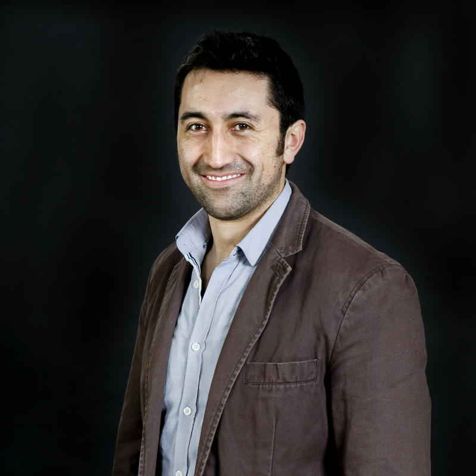

\thispagestyle{fancy}

::: {layout="[70,-3,20]"}

:::col

# Fabio A. CRUZ SANCHEZ  \includegraphics[width=2ex]{figures/flag-colombia.png} \includegraphics[width=2ex]{figures/flag-france.png} 

 8 Rue Bastien Lepage, 54000 Nancy, France |  +33.3.72.74.35.58  \newline 

 [fabio.cruz@univ-lorraine.fr](mailto:fabio.cruz@univ-lorraine.fr) |   [fabbiocrux.com](https://fabbiocrux.com/) |
 [fabbiocrux](https://github.com/fabbiocrux)
| \aiGoogleScholar \ \href{https://scholar.google.fr/citations?user=8Cuoaf4AAAAJ&hl=fr}{Google scholar} 
\newline
CNU **60**, 62 \newline

*Fabrication Aditiva; Open Source; Reciclaje Distribuido; Sostenibilidad*

:::

{width="3cm"}
:::

## Presentación 

Profesor en la [École Nationale Supérieure en Génie des Systèmes et de l'Innovation --ENSGSI-](https://ensgsi.univ-lorraine.fr/nos-formations/), adscrita al laboratorio de investigación  [ Équipe de Recherche sur les Processus Innovatifs -- ERPI-](https://erpi.univ-lorraine.fr/) de la Université de Lorraine en Francia.
Ingeniero mecánico formado en la Universidad Nacional de Colombia, poseo un Máster II en Gestión de la Innovación y Diseño Industrial, así como un doctorado en Ingeniería de Sistemas Industriales por la Université de Lorraine.
Mi área de investigación se centra en la fabricación aditiva de código abierto como palanca para el desarrollo industrial sostenible. 
Más concretamente, estoy estudiando nuevos canales de distribución cortos para la recuperación de plásticos reciclados mediante la fabricación aditiva.
Adopto un enfoque multiescala para abordar las cuestiones tecnológicas, industriales y territoriales asociadas, al tiempo que favorezco la colaboración con diversas partes interesadas. Utilizo distintas metodologías para mejorar, probar y experimentar nuevos usos.
Tengo una sólida experiencia en la dirección de proyectos de investigación (EU H2020, ANR) y de formación (ERASMUS+).

<!-- Mon travail se décompose en trois échelles fondamentales. Un premier échelle porte  sur la validation du procédé d’impression 3D open source en tant qu’outil reproductible pour la fabrication des pièces imprimées en thermoplastique. Une attention particulière est portée sur la précision géométrique, résistance mécanique et vibratoire de ce procédé à l’échelle industrielle standard. Une deuxième échelle centrale est la faisabilité technique et logistique du recyclage des thermoplastiques pour les processus d’impression. J’ai travaillé pendant ma thèse sur les caractérisations mécaniques et chimiques de la matière recyclée dans la chaîne d’impression en co-tutelle avec l’Équipe de Recherche sur les Processus Innovatifs (ERPI) et le Laboratoire des Réactions et Génie des Procédés (LRGP — UMR 7274) à Nancy. Je collabore avec le groupe de recherche FAST (Free Appropriate Sustainability Technology) de Western University de Canada sur le développement open source hardware dans une vision de démocratisation de la technologie associé au recyclage distribué. Une troisième échelle en cours de développement est l’analyse de la soutenabilité d’une filière de recyclage distribuée en collaboration avec l’équipe InSyTe de l’Université Technologique de Troyes. Le développement d’indicateurs (au-delà des indicateurs technico-économiques) intégrant la capacité de charge des écosystèmes et leurs services est un enjeu prometteur pour rendre les filières industrielles plus résilientes.

J'ai une forte expérience en montage et conduite de projet européens. J'ai l'opportunité de mettre en œuvre ces travaux de recherche dans le cadre du projet H2020 [INEDIT](http://erpi.univ-lorraine.fr/projects/INEDIT/) qui vise le transfert des approches ‘Do-It-Yourself’ (DIY) vers un contexte industriel.  Je développe donc le démonstrateur de recyclage des plastiques pour l’impression 3D (le [*Green Fablab*](https://lf2l.fr/projects/green-fablab/^[https://lf2l.fr/projects/green-fablab/]))  afin de tester l’approche appelée ‘Do-It-Together’ (DIT). C’est une excellente opportunité pour mieux comprendre l’opérationnalisation et la démultiplication de la démarche de recyclage distribué auprès des acteurs et des communautés locales. En parallèle, je pilote également dans le projet [Erasmus+ Climatelabs](https://erpi.univ-lorraine.fr/fr/projects/Climatelabs/) qui cherche à renforcer les capacités de recherche appliquée et d’innovation de dix universités partenaires du Mexique, du Brésil et de la Colombie par la conception et la mise en œuvre des espaces d’innovation sociales pour l’atténuation et l’adaptation au  changement climatique. -->

## Formación

<!-- 
:::{.minipage options="[t]" arguments="0.4\textwidth"}

2013 -- 2016

:::
\hfill
:::{.minipage options="[t]" arguments="0.4\textwidth"}

:::

:::{layout="[15,85]" layout-valign="top"}
:::{}
2013 -- 2016
:::

:::{}
**Ph.D., Université de Lorraine**, spécialité Génie des systèmes industriels \par

Titre de thèse: *Methodological proposition to evaluate polymer recycling in open-source additive manufacturing contexts* 

Défendu publiquement le 9 Décembre de 2016 à Nancy devant le jury:\par\vspace{5pt}

**Rapporteurs**:

- *Prof.* Nicolas PERRY --  ENSAM, Bordeaux - France
- *Dr.* Salim BELOUETTAR -- LIST, Esch-sur-Alzette - Luxembourg

\vspace{5pt}
**Examinateurs**:

- *Prof.* Joshua M. PEARCE -- MTU, Michigan - USA
- *Prof.* Nadia BAHLOULI -- Université de Strasbourg, Strasbourg - France
- *Prof.* Mauricio CAMARGO (*Directeur*) -- UL, ERPI, Nancy - France
- *MdC.* Hakim BOUDAOUD (co-directeur*) -- UL ERPI, Nancy - France
- *Dr.* Sandrine HOPPE (co-directeur*)  --  LRGP, Nancy - France

:::
::: -->

\begin{tabu} to \linewidth {X[0.3,l] X[2,l]}

2013 -- 2016 & \textbf{Ph.D., Université de Lorraine}, Especialidad Ingeniería de Sistemas Industriales \par
	Titulo de Tesis: \textbf{\emph{Methodological proposition to evaluate polymer recycling in open-source additive manufacturing contexts}} \par\vspace{5pt}
	
Defendida públicamente el 9 de diciembre de 2016 en Nancy ante el jurado:\par\vspace{5pt}

	\textbf{Rapporteurs:}
	\begin{itemize}
	
	    \item \textit{Prof.} Nicolas PERRY --  ENSAM, Bordeaux - France
	    \item \textit{Dr.} Salim BELOUETTAR -- LIST, Esch-sur-Alzette - Luxembourg
	\end{itemize}

\vspace{5pt}
	\textbf{Examinateurs:}
	\begin{itemize}
	
	    \item \textit{Prof.} Joshua M. PEARCE -- MTU, Michigan - USA
	    \item \textit{Prof.} Nadia BAHLOULI -- Université de Strasbourg, Strasbourg - France
	    \item \textit{Prof.} Mauricio CAMARGO (\textit{Directeur}) -- UL, ERPI, Nancy - France	    
	    \item \textit{MdC.} Hakim BOUDAOUD (\textit{co-directeur}) -- UL ERPI, Nancy - France	    
	    \item \textit{Dr.} Sandrine HOPPE (\textit{co-directeur})  --  LRGP, Nancy - France
	\end{itemize}
		\\ [5pt]

2012 -- 2013 &
	\textbf{Master II.~ Management de l'Innovation et du Desing Industriel, Université de Lorraine, FR} \par Tesis: \emph{Proposition d'un Protocole d'expérimentation standard pour la fabrication additive open source} \\[5pt]

2004 -- 2012 &
	\textbf{B.Sc. Ingénieur Mécanique}, Universidad Nacional de Colombia, Bogotá, Colombia \\
	
\end{tabu}

\vspace{-0.25cm}

## Experiencia profesional

\extrarowsep=3pt
\begin{tabu} to \linewidth {X[0.3,l] X[2,l]}

2024 -- ... &
	\textbf{Profesor Asistente} \emph{Université de Lorraine}, Nancy -- France \\[5pt]

2022 -- 2023 &
	\textbf{Investigador} \emph{Université de Lorraine},  Nancy -- France \\[5pt]

2021 -- 2021 &
	\textbf{Investigador} \emph{Université de Technologique de Troyes}, Équipe InSyTe (Antiguamente CREIDD) Troyes -- France \\[5pt]

2017 -- 2021 &
	\textbf{Post-doctorante} \emph{Laboratoire ERPI}, Université de Lorraine, Nancy -- France \\[5pt]

2010 -- 2011 & \textbf{International trainee} \href{http://www.mipengenharia.com.br/}{Empresa MIP Engenharia S/A} \thinspace Belo Horizonte, Brazil \par
\textit{Proyecto:} Ayudar a crear un plan estratégico para el proyecto de internacionalización del PIM.  \\
	
2008 -- 2009 &
	\textbf{Estudiante auxiliar de ingeniería} \emph{Universidad Nacional de Colombia. Bogotá - Colombia}	\par 
	\emph{Projet:} Diseño y construcción de una máquina de fundición centrífuga para fabricar cilindros de fundición ASTM 40. \\
\end{tabu}

## Competencias

\extrarowsep=3pt
\begin{tabu} to \linewidth {X[0.1,l] X[2,l]}

\faIcon{language}  & 
\includegraphics[width=2ex]{figures/flag-colombia.png} Lengua materna\quad 
\includegraphics[width=2ex]{figures/flag-france.png} C2  \quad\includegraphics[width=2ex]{figures/flag-usa.png} C1  \quad
\includegraphics[width=2ex]{figures/flag-brazil.png} B2 \\[5pt] 

\faIcon{laptop}  & CAO (Solid-Works, Onshape), Matlab,  Data analysis / visualización, R, \textsc{Html, css} \\[5pt]
	
\faIcon{book}  & Investigación,  Zotero, \LaTeX ~and Rmarkdown/Quarto publishing.

\end{tabu}

## Liste de la Production Scientifique {#articles}

<!-- ### Articles soumis récemment (en attente de décision) : -->
<!-- 1. Santander P., Bautista S, **Cruz Sanchez, F.A.**, Boudaoud, H., Camargo, M., Pearce, J.M., 2020. *"Toward distributed local recycling networks for plastic waste: A system dynamics-based approach (Part I)"*. Technological Forecasting & Social Change. **(Soumis en Mars 2022– en révision)** -->

### Articles à comité de lecture dans des revues internationales

1. Romani, A., Bogoya, A.B., Cruz Sanchez, F.A., Boudaoud, H., Camargo, M., Pearce, J.M., 2026. Open source technology readiness level assessment and application to the case study of distributed recycling for additive manufacturing. Technological Forecasting and Social Change 229, 124700. [https://doi.org/10.1016/j.techfore.2026.124700](https://doi.org/10.1016/j.techfore.2026.124700)

1. Suescun Gonzalez, C., Sandei, B., **Cruz Sanchez, F.A.**, Hoppe, S., Boudaoud, H., Pearce, J.M., Nouvel, C., 2026. Compatibilizer effectiveness for the reuse of mixed post-consumer solid waste plastic towards Distributed recycling additive manufacturing. Materials Today Sustainability 34, 101323. https://doi.org/10.1016/j.mtsust.2026.101323

1. Gonzalez, C.S., Basdeo, A., **Cruz Sanchez, F.A**., Nouvel, C., Pearce, J.M., Boudaoud, H., 2025. Strategies for recycling multi-material polymer blends for additive manufacturing. Sustainable Materials and Technologies 44, e01430. https://doi.org/10.1016/j.susmat.2025.e01430

1. Liu, D., Basdeo, A., Gonzalez, C.S., Romani, A., Boudaoud, H., Nouvel, C., **Cruz Sanchez, F.A.**, Pearce, J.M., 2024. Low-Cost Open-Source Melt Flow Index System for Distributed Recycling and Additive Manufacturing. Materials 17, 5966. https://doi.org/10.3390/ma17235966

1. Suescun Gonzalez, C., **Cruz Sanchez, F.A.**, Boudaoud, H., Nouvel, C., Pearce, J.M., 2024. Multi-material distributed recycling via material extrusion: recycled high density polyethylene and poly (ethylene terephthalate) mixture. Polymer Engineering & Science. [https://doi.org/10.1002/pen.26643](https://doi.org/10.1002/pen.26643)

1. Osorio, F., **Cruz, F.**, Camargo, M., Dupont, L., Peña, J.I., 2024. Exploring team roles for social innovation labs: Toward a competence-based role self-assessment approach. Journal of Engineering and Technology Management 71, 101799. [https://doi.org/10.1016/j.jengtecman.2024.101799](https://doi.org/10.1016/j.jengtecman.2024.101799)

1. Caceres-Mendoza, C., Santander-Tapia, P., **Cruz Sanchez, F.A.**, Troussier, N., Camargo, M., Boudaoud, H., 2023. Life cycle assessment of filament production in distributed plastic recycling via additive manufacturing. Cleaner Waste Systems 5, 100100. [https://doi.org/10.1016/j.clwas.2023.100100](https://doi.org/10.1016/j.clwas.2023.100100)

1. Xue, F., Boudaoud, H., Robin, G., A. **Cruz Sanchez, F.**, Daya, E.M., 2023. Enhancing vibration damping properties of additively manufactured viscoelastic structures through process parameter optimization. Mechanics of Advanced Materials and Structures 0, 1–11. [https://doi.org/10.1080/15376494.2023.2245827](https://doi.org/10.1080/15376494.2023.2245827)

1. Gabriel, A., **Cruz, F.**, 2023. Open source IoT-based collection bin applied to local plastic recycling. HardwareX 13, e00389. [https://doi.org/10.1016/j.ohx.2022.e00389](https://doi.org/10.1016/j.ohx.2022.e00389)

1. López, V.M., Carou, D., **Cruz S, F.A.**, 2022. Feasibility study on the use of recycled materials for prototyping purposes: A comparative study based on the tensile strength. Proceedings of the Institution of Mechanical Engineers, Part B: Journal of Engineering Manufacture 09544054221113378. [https://doi.org/10.1177/09544054221113378](https://doi.org/10.1177/09544054221113378)

1. Xue, F., Robin, G., Boudaoud, H., **Cruz Sanchez, F.A.**, Daya, E.M., 2022. General Methodology to Investigate the Effect of Process Parameters on the Vibration Properties of Structures Produced by Additive Manufacturing Using Fused Filament Fabrication. JOM 74, 1166–1175. [https://doi.org/10.1007/s11837-021-05051-9](https://doi.org/10.1007/s11837-021-05051-9)

1. Santander, P., **Cruz Sanchez, F.A**., Boudaoud, H., Camargo, M., 2022. Social, political, and technological dimensions of the sustainability evaluation of a recycling network. A literature review. Clean. Eng. Technol. [https://doi.org/10.1016/j.clet.2022.100397](https://doi.org/10.1016/j.clet.2022.100397)

1. Alexandre, A., **Cruz Sanchez, F.A.**, Boudaoud, H., Camargo, M., Pearce, J.M., 2020. Mechanical Properties of Direct Waste Printing of Polylactic Acid with Universal Pellets Extruder: Comparison to Fused Filament Fabrication on Open-Source Desktop Three-Dimensional Printers. 3D Print. Addit. Manuf. 3dp.2019.0195. [https://doi.org/10.1089/3dp.2019.0195](https://doi.org/10.1089/3dp.2019.0195)

1. Santander, P., **Cruz Sanchez, F.A.**, Boudaoud, H., Camargo, M., 2020. Closed loop supply chain network for local and distributed plastic recycling for 3D printing: a MILP-based optimization approach. Resour. Conserv. Recycl. 154, 104531. [https://doi.org/10.1016/j.resconrec.2019.104531](https://doi.org/10.1016/j.resconrec.2019.104531)

1. **Cruz Sanchez, F.A.**, Boudaoud, H., Camargo, M., Pearce, J.M., 2020. Plastic recycling in additive manufacturing: A systematic literature review and opportunities for the circular economy. J. Clean. Prod. 264, 121602. [https://doi.org/10.1016/j.jclepro.2020.121602](https://doi.org/10.1016/j.jclepro.2020.121602)

1. **Cruz Sanchez, F.A.**, Boudaoud, H., Hoppe, S., Camargo, M., 2017. Polymer recycling in an open-source additive manufacturing context: Mechanical issues. Addit. Manuf. 17, 87–105. [https://doi.org/10.1016/j.addma.2017.05.013](https://doi.org/10.1016/j.addma.2017.05.013)

1. **Cruz Sanchez, F.A.**, Boudaoud, H., Muller, L., Camargo, M., 2014. Towards a standard experimental protocol for open source additive manufacturing. Virtual Phys. Prototyp. 9, 151–167. [https://doi.org/10.1080/17452759.2014.919553](https://doi.org/10.1080/17452759.2014.919553)

### Communications dans des congrès internationaux à comité de lecture 

1. Xue, F., Boudaoud, H., Robin, G., **Cruz Sanchez, F. A.**, & Daya, E. M. (2022). Influence of layer thickness and nozzle temperature on the interlocking adhesion strength of additive manufactured multi-material interface. In 2022 International Solid Freeform Fabrication Symposium.

1. Xue, F., Robin, G., Boudaoud, H., **Cruz Sanchez, F. A.**, & Daya, E. M. (2021). Effect of process parameters on the vibration properties of PLA structure fabricated by additive manufacturing. In 2021 International Solid Freeform Fabrication Symposium. University of Texas at Austin.

2. Roux-Marchand, T., **Cruz, F**., Dupont, L., Camargo, M., Osorio, F., 2020. Connecting the strategic intent of innovation labs and projects: the case of the Green Fablab, in: 2020 IEEE International Conference on Engineering, Technology and Innovation (ICE/ITMC). IEEE, pp. 1–10. https://doi.org/10.1109/ICE/ITMC49519.2020.9198320

3. Pavlo, S., **Fabio, C**., Hakim, B., Mauricio, C., 2018. 3D-Printing Based Distributed Plastic Recycling: A Conceptual Model for Closed-Loop Supply Chain Design, in: 2018 IEEE International Conference on Engineering, Technology and Innovation (ICE/ITMC). IEEE, pp. 1–8. https://doi.org/10.1109/ICE.2018.8436296

4. Albuquerque, R., Arbelaez, G., **Cruz, F.**, Camargo, M., Joseph, D., Tran, N., 2018. Modelling, Printing and Validation of Dental Dry Models for Implantology Skills Training, in: 2018 IEEE International Conference on Engineering, Technology and Innovation (ICE/ITMC). IEEE, pp. 1–8. https://doi.org/10.1109/ICE.2018.8436302

5. **Cruz, F.**, Lanza, S., Boudaoud, H., Hoppe, S., Camargo, M., 2015. Polymer Recycling and Additive Manufacturing in an Open Source context : Optimization of processes and methods, in: Solid Freeform Fabrication. Austin, Texas, pp. 1591–1600.

### Chapitre d'Ouvrages scientifiques

1. Mendoza, C.C., Tapia, P.S., **Cruz, F**., Troussier, N., Camargo, M., Boudaoud, H., 2024. *Chapitre 5 : Fabrication additive : le recyclage local de plastique*, in: Territoires en transition et innovation: Enjeux et outils d’accompagnement. p. 137.

1. **Cruz, F.**, Lanza, S., Boudaoud, H., Hoppe, S., Camargo, M., *"Approche méthodologique pour évaluer la faisabilité du recyclage des polymères dans un contexte de fabrication additive open-source"* (2023). Le recyclage, enjeu pour l’économie circulaire. ISTE Group

2.  Pavlo, S., **Fabio, C.**, Hakim, B., Mauricio, C.,*"Recyclage distribué en circuit court de plastiques revalorisés par l’impression 3D  « Open Source »: Un cadre pour l'analyse et l'évaluation de sa durabilité"* (2023). Le recyclage, enjeu pour l’économie circulaire. ISTE Group

### Colloques et congrès nationales

1. Marche, B., Kasmi, F., **Sanchez, F.**, Mayer, F., & Dupont, L. (2020, March). From technological demonstrator to sustainable supply chain demonstrator: a conceptual framework. In Spring of Innovation.

2. **Fabio Cruz**, Hakim Boudaoud, Sandrine Hoppe, Mauricio Camargo. Le concept du Green Fablab: une approche distribuée pour le recyclage de polymères en circuit-court dans le cadre de la fabrication additive open-source. 15ème Congrès de la Société Française de Génie des Procédés (SFGP), Jul 2017, Nancy, France. ⟨hal-02518997⟩

# Encadrement Doctoral et Scientifique

## Au niveau Master
(2025) Nicolas Carcamo: *Assessing the Sustainability of the Plastics Industry: A System Dynamics and Optimization Approach*. 100%

(2024) Rodrigo Contrera Nuñez: *Techno-ecological synergies for a post-growth distributed recycling context: A complementary approach of Life cycle assessments and ecosystem services*. 50%

(2024) Alfonso Enrique Suarez: *Proposal for a business model for the management of household plastic*. 50%
(2023) Ignacio Castaneda: *Proposal of a local distributed recycling optimization model: application to plastics and metals obtained from e-waste* . 50%

(2022) Cristian Caceres: *Recyclage distribué des déchets plastiques et rôle de la fabrication additive : proposition d’un modèle d’affaire économique et environnemental*. 50%

(2021) Swapnil Balpande: *Quality in Fused Granular Deposition for distributed recycling*. 50%

(2020) Anamaria Barrera Bogoya: *A smart grid of plastics – Technical conditions for the sorting and pre-step evaluation for a “factory of the future”*. 50%
(2019) Arthur Alexandre: *Mechanical Properties of Direct Waste Printing of Polylactic Acid with Universal Pellets Extruder: Comparison to Fused Filament Fabrication on Open-Source Desktop Three-Dimensional Printers*. 50%
(2018) Pavlo Santander: *3D-Printing based distributed plastic recycling: A  conceptual model for closed-loop supply chain  design* 50%
(2017) Ramsés Albuquerque: *Modelling, printing and validation of dental dry  models for implantology skills training* 50%
(2016) Silvia Lanza: *Polymer Recycling and Additive Manufacturing in an Open Source  context: Optimization of processes and methods* 50%

